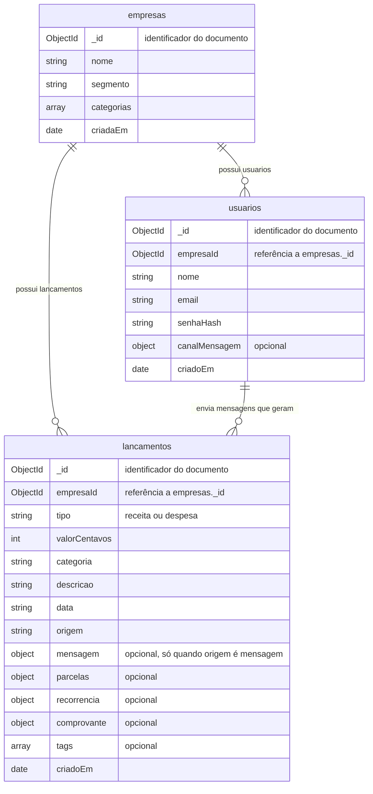
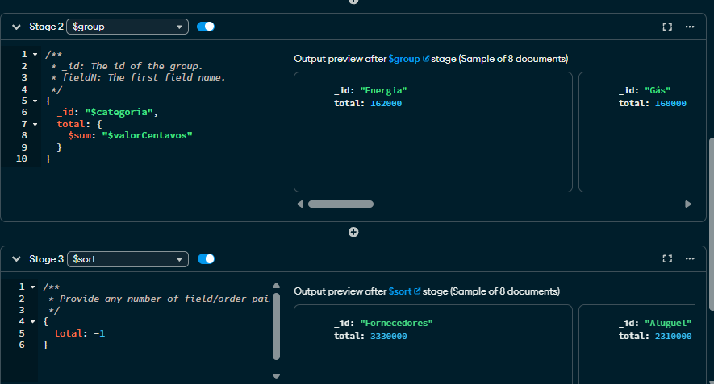
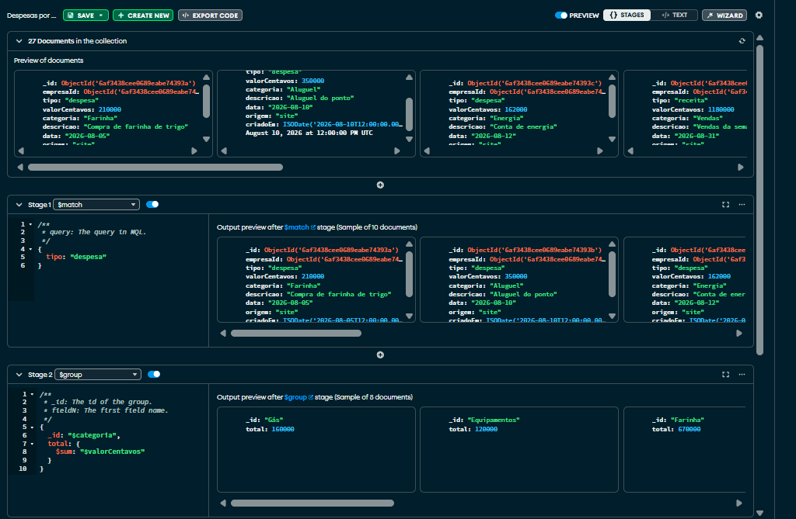
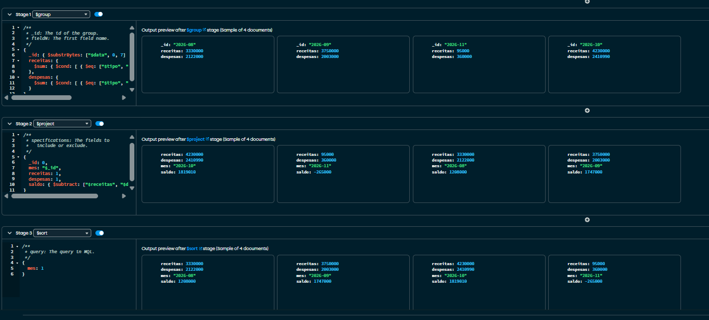

# Fala_FinBot: modelo de dados em MongoDB

Repositório acadêmico da disciplina de NoSQL. Ele reúne a descrição do sistema **Fala_FinBot** (nome provisório) e o código em Python que cria o banco, as coleções e documentos de exemplo no MongoDB online (MongoDB Atlas) e que expõe as duas agregações em uma API.

## 1. Descrição do sistema

O Fala_FinBot é um sistema de administração financeira para pequenos negócios. O dono da padaria, da loja de roupas ou da clínica lança receitas e despesas de duas formas: pelo site, preenchendo um formulário, ou simplesmente mandando uma mensagem em um chat, como "paguei 180 de energia hoje". Uma inteligência artificial lê o texto, descobre se é receita ou despesa, o valor, a categoria e a data, e registra o lançamento. Um painel web compara receitas e despesas entre meses e categorias.

### O problema

Todo dono de negócio precisa saber quanto entra e quanto sai, mas a maioria desiste de controlar porque registrar tudo em planilhas ou em sistemas cheios de campos dá trabalho. Sem controle, ele descobre que o mês fechou no vermelho só quando o dinheiro já acabou.

### Como o sistema resolve

A entrada de dados fica tão simples quanto mandar uma mensagem. O fluxo de uma mensagem é este:

1. O dono escreve no chat, em texto livre.
2. O sistema identifica quem é o usuário e de qual empresa ele é, e manda a mensagem para a IA junto com a data de hoje e as categorias daquela empresa.
3. A IA devolve uma interpretação (tipo, valor, categoria, data e um grau de confiança), que só vai para o banco junto com o lançamento, dentro do campo `mensagem`.
4. Se a confiança for baixa ou faltar alguma informação, o sistema pergunta ao dono antes de gravar. Se for alta, pode gravar direto e avisar, com a opção de desfazer.
5. Confirmada a interpretação, o sistema cria o lançamento, que é o registro oficial e alimenta o painel, e guarda dentro dele a mensagem original e o que a IA entendeu.

A IA só interpreta o texto. As somas, os comparativos e os filtros do painel são feitos pelo banco, que é exato.

### Várias empresas no mesmo sistema

Muitos negócios usam o mesmo sistema, mas um nunca enxerga os dados do outro. Por isso quase todo documento carrega o `empresaId`, e as consultas sempre filtram por ele. Cada empresa também define as próprias categorias: uma padaria tem "Farinha" e "Gás", uma loja de roupas tem "Fornecedores" e "Marketing".

### O que o sistema não faz

Ele controla o fluxo de caixa. Não gera balanço patrimonial, e uma DRE completa também ficaria de fora, porque o registro é feito pelo regime de caixa, quando o dinheiro entra ou sai.

### Por que MongoDB

Os pontos em que o modelo de documento ajuda de verdade são três. O primeiro é a interpretação da IA, que tem formato variável e fica guardada junto com o texto original e o status, dentro do próprio lançamento, o que dá um histórico do que a IA entendeu e permite medir a taxa de acerto. O segundo são os campos opcionais dos lançamentos: um lançamento simples tem só os campos básicos, e um parcelado, recorrente ou com comprovante carrega a mais o que precisa, sem colunas vazias. O terceiro é que as categorias de cada empresa ficam dentro do documento dela, sem tabela extra.

Para ser honesto, esse sistema também poderia ser feito em um banco relacional, e um Postgres com campos JSON resolveria boa parte. A escolha pelo MongoDB aqui se apoia no encaixe do modelo de documento com o fluxo de mensagens e interpretações, e não em uma limitação do SQL. Mesmo sendo flexível, o banco valida os documentos com `$jsonSchema`, para não aceitar dado errado, e o dinheiro é guardado em centavos, como número inteiro, para não ter erro de arredondamento.

## 2. Modelagem

O modelo tem 3 coleções. Os objetos que só fazem sentido dentro de um documento ficam embutidos nele, e o que precisa existir sozinho ou ser consultado por conta própria fica em outra coleção, ligado por identificador. A mensagem do chat não tem coleção própria: ela fica embutida no lançamento que gerou.

Os nomes no diagrama representam documentos das coleções, e as linhas indicam referências por identificador (o MongoDB não impõe integridade referencial, então quem mantém essas referências é a aplicação). As regras de validação e os índices estão em `backend/app/schemas.py`.



O que aparece como `object` ou `array` não é outra coleção: fica dentro do próprio documento. O campo `mensagem` guarda o `usuarioId` de quem mandou (referência a `usuarios._id`), o texto, a data de recebimento, a interpretação da IA e o status, que pode ser `confirmada`, `corrigida` ou `automatica`.

### Embutir ou referenciar

| Decisão | Justificativa |
|---|---|
| `mensagem` embutida em `lancamentos` | O texto original e a resposta da IA só importam junto com o lançamento que eles geraram, e são sempre lidos com ele. Guardar tudo junto também permite medir a taxa de acerto depois, sem uma coleção a mais. |
| `categorias` embutidas em `empresas` | Cada empresa define as suas, são poucas e sempre lidas junto com a empresa, então não vale uma coleção à parte. |
| `canalMensagem` embutido em `usuarios` | É só o chat do usuário (tipo e id), pequeno e usado para descobrir a empresa a partir da mensagem recebida. |
| `parcelas`, `recorrencia`, `comprovante` e `tags` embutidos em `lancamentos` | São campos opcionais que pertencem a um único lançamento. Quem não usa não carrega nada. |
| `lancamentos` como coleção separada | É o registro oficial e existe mesmo sem mensagem, quando vem do site. Também é a coleção que o painel mais consulta e soma. |
| `usuarios` como coleção separada | O usuário faz login por conta própria e é buscado por e-mail ou pelo chat, sem passar pela empresa. |
| `empresaId` em quase tudo | É a referência que isola os dados de cada negócio, e as consultas sempre filtram por ela. |
| `mensagem.usuarioId` | Liga o lançamento ao usuário que mandou a mensagem, para saber quem registrou cada um. |

### Interesse do usuário

| Coleção | O que o dono quer saber | Agregação prevista |
|---|---|---|
| `lancamentos` | Onde o dinheiro está indo e como cada mês fechou | `$match`, `$group` e `$sort` por categoria; `$group`, `$project` e `$sort` por mês |
| `lancamentos` (campo `mensagem`) | Se a IA está acertando as classificações | `$match` nos lançamentos que têm mensagem e `$group` por `mensagem.status` |
| `empresas` | Quais categorias cada negócio usa | `$unwind` na lista de `categorias` |
| `usuarios` | Quem tem acesso à empresa | Consulta simples por `empresaId`, sem agregação |

## 3. O banco de dados

O banco se chama `finbot` e tem 3 coleções:

| Coleção | O que guarda |
|---|---|
| `empresas` | Cada negócio que usa o sistema, com o segmento e as categorias de receita e despesa que ele definiu |
| `usuarios` | O dono (ou quem a empresa autoriza): login por e-mail e senha (só o hash) e o canal do chat, que liga a mensagem recebida à empresa certa |
| `lancamentos` | O registro oficial de receitas e despesas, vindo do chat ou do site. Quando vem do chat, guarda embutida a mensagem original, a interpretação da IA e o status. É a base do painel |

As ligações entre elas são feitas por identificadores. `usuarios` e `lancamentos` apontam para a empresa por `empresaId`, e a mensagem embutida no lançamento aponta para quem a mandou por `mensagem.usuarioId`. Lançamentos feitos pelo site não têm o campo `mensagem`.

O status da mensagem embutida pode ser `confirmada`, `corrigida` (o dono ajustou algum campo) ou `automatica` (gravada sem perguntar, por confiança alta). As mensagens que ainda esperam resposta do dono (`pendente`) ou que ele recusou (`descartada`) não geram lançamento e, por isso, não são guardadas no banco.

Um exemplo de documento da coleção `lancamentos`, vindo do chat:

```json
{
  "empresaId": "ObjectId(...)",
  "tipo": "despesa",
  "valorCentavos": 18000,
  "categoria": "Energia",
  "descricao": "Conta de energia",
  "data": "2026-10-29",
  "origem": "mensagem",
  "mensagem": {
    "usuarioId": "ObjectId(...)",
    "texto": "paguei 180 de energia hoje",
    "recebidaEm": "2026-10-29T22:20:00Z",
    "interpretacao": {
      "tipo": "despesa",
      "valorCentavos": 18000,
      "categoria": "Energia",
      "data": "2026-10-29",
      "confianca": 0.94
    },
    "status": "confirmada"
  },
  "criadoEm": "2026-10-29T22:21:00Z"
}
```

## 4. Estrutura do repositório

```
Fala_FinBot/
├── README.md                 este arquivo
├── .gitignore                impede que o .env (com a senha) e a pasta .venv subam para o GitHub
├── prints/                   prints das consultas executadas
└── backend/
    ├── requirements.txt      dependências do Python (FastAPI, pymongo, uvicorn, python-dotenv)
    ├── .env.example          modelo do arquivo .env (a connection string)
    └── app/
        ├── config.py         lê a connection string do arquivo .env
        ├── db.py             conexão com o MongoDB
        ├── schemas.py        as 3 coleções: regras de validação ($jsonSchema) e índices
        ├── seed.py           documentos de exemplo (2 empresas fictícias)
        ├── setup_db.py       cria o banco, as coleções, os índices e insere os exemplos
        ├── queries.py        as 2 agregações (Funcionalidade1 e Funcionalidade2)
        └── main.py           a API (FastAPI) que expõe as agregações
```

## 5. Como rodar

Você precisa do [Python](https://www.python.org) 3.10 ou mais novo e de uma conta gratuita no [MongoDB Atlas](https://www.mongodb.com/cloud/atlas/register).

### Criar o banco online

1. No Atlas, clique em **Create**, escolha o cluster gratuito **M0 (Free)**, a região **São Paulo (sa-east-1)** e crie o cluster.
2. Crie o usuário do banco (usuário e senha) e guarde a senha.
3. Em **Network Access**, adicione o seu IP com **Add Current IP Address**.
4. Em **Database, Connect, Drivers**, copie a connection string (`mongodb+srv://...`) e troque `<db_password>` pela senha do passo 2.

### Configurar e executar

```bash
git clone <endereço deste repositório>
cd Fala_FinBot/backend
python -m venv .venv
.venv\Scripts\activate           # no Linux ou Mac: source .venv/bin/activate
pip install -r requirements.txt
cp .env.example .env              # depois edite o .env e cole a sua connection string, terminando em /finbot
python -m app.setup_db            # cria o banco "finbot", as 3 coleções, os índices e os exemplos
uvicorn app.main:app --reload     # sobe a API em http://localhost:8000
```

O arquivo `.env` não vai para o repositório (está no `.gitignore`), então a senha do banco fica só na sua máquina.

| Comando | O que faz |
|---|---|
| `python -m app.setup_db` | Cria o que falta. Coleções que já têm dados não são alteradas |
| `python -m app.setup_db --reset` | Apaga as 3 coleções e cria tudo de novo |

Depois do `setup_db`, os dados aparecem no Atlas em **Database, Browse Collections, finbot**.

Todos os dados de exemplo (empresas, e-mails, identificadores de chat, valores) são fictícios. O hash de senha dos usuários de exemplo também é inventado e não corresponde a nenhuma senha real.


## 6. Consultas (views)

As duas consultas abaixo foram criadas no MongoDB Atlas como views da coleção `lancamentos`. Cada uma é um aggregation pipeline, ou seja, uma sequência de estágios em que a saída de um alimenta o próximo. Os valores estão guardados em centavos. As mesmas agregações também são executadas pela API, descrita na seção 7.

### View `Funcionalidade1`: despesas por categoria

Mostra quanto foi gasto em cada categoria, da maior despesa para a menor. Serve para o dono ver rapidamente onde o dinheiro está indo.

1. `$match` deixa passar só os lançamentos do tipo despesa.
2. `$group` agrupa os lançamentos pela categoria e soma o valor de cada grupo.
3. `$sort` ordena do maior total para o menor.

```js
[
  { $match: { tipo: "despesa" } },
  { $group: { _id: "$categoria", total: { $sum: "$valorCentavos" } } },
  { $sort: { total: -1 } }
]
```

Com os dados de exemplo, a categoria com maior gasto é Fornecedores, e a menor é Internet. Como a coleção reúne as duas empresas de exemplo, categorias com o mesmo nome (como Aluguel) aparecem somadas.





### View `Funcionalidade2`: resumo mensal

Compara receitas e despesas de cada mês e calcula o saldo (receitas menos despesas). Serve para acompanhar se o negócio fechou o mês no azul ou no vermelho.

1. `$group` agrupa os lançamentos por mês, recortando os sete primeiros caracteres da data (por exemplo, `2026-10`). Em cada grupo, um `$cond` soma o valor só dos lançamentos de receita em um campo e só dos de despesa em outro.
2. `$project` mostra o mês, as receitas e as despesas, e cria o campo `saldo` com a diferença entre os dois.
3. `$sort` ordena os meses do mais antigo para o mais recente.

```js
[
  { $group: {
      _id: { $substrBytes: ["$data", 0, 7] },
      receitas: { $sum: { $cond: [ { $eq: ["$tipo", "receita"] }, "$valorCentavos", 0 ] } },
      despesas: { $sum: { $cond: [ { $eq: ["$tipo", "despesa"] }, "$valorCentavos", 0 ] } }
  } },
  { $project: { _id: 0, mes: "$_id", receitas: 1, despesas: 1, saldo: { $subtract: ["$receitas", "$despesas"] } } },
  { $sort: { mes: 1 } }
]
```

Com os dados de exemplo, os meses de agosto a outubro fecham com saldo positivo. Novembro aparece negativo porque os lançamentos de exemplo só vão até o início do mês e as despesas dos primeiros dias vieram antes das vendas.



## 7. API

O backend em Python (FastAPI) está em `backend/`. Ele executa as duas agregações direto no MongoDB, com os mesmos pipelines das views, e devolve o resultado em JSON. Os valores continuam em centavos.

| Rota | O que devolve |
|---|---|
| `GET /health` | Confere se a API consegue falar com o banco |
| `GET /api/funcionalidade1` | Despesas por categoria, da maior para a menor (`categoria` e `totalCentavos`) |
| `GET /api/funcionalidade2` | Receitas, despesas e saldo de cada mês (`mes`, `receitasCentavos`, `despesasCentavos` e `saldoCentavos`) |

As duas rotas aceitam o parâmetro opcional `empresaId` (por exemplo, `/api/funcionalidade1?empresaId=...`), que restringe o resultado a uma empresa. Sem ele, o resultado considera todas, igual às views do Atlas. Um `empresaId` que não seja um identificador válido devolve erro 422.

Com a API no ar, a documentação interativa, onde dá para testar as rotas pelo navegador, fica em `http://localhost:8000/docs`.

### Próxima entrega: cache com Redis

Os pipelines ficam isolados em `backend/app/queries.py`, e as rotas só chamam essas funções. É ali que o cache vai entrar: antes de consultar o MongoDB, a função procura o resultado no Redis, em uma chave por consulta e empresa (por exemplo, `fin:f1:{empresaId}`), com tempo de expiração. O cache será invalidado quando um lançamento novo for gravado, para o painel não mostrar número velho.
